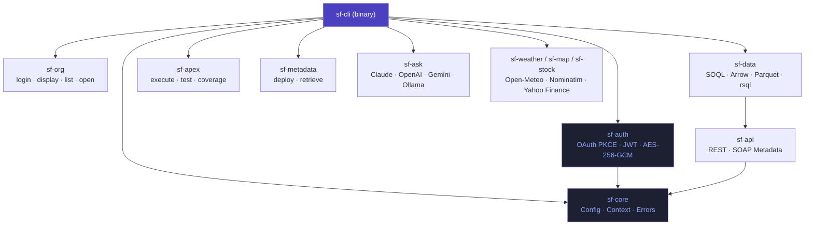
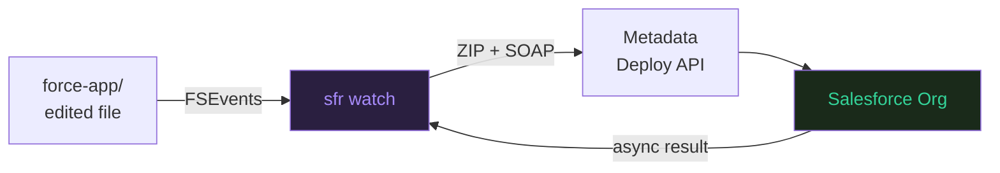

# 🦀 sf-rust

### Native Salesforce Developer CLI — Pure Rust

> No Node.js · No npm · Single statically-linked binary · 2–10× faster


**Mohan Chinnappan**

---

## Why sf-rust?

| | What you get |
|---|---|
| ⚡ 2–10× faster startup | No JVM / Node.js cold-start overhead |
| 🔐 AES-256-GCM credentials | Encrypted at rest in `~/.sf-rust/` |
| 📦 Single binary | `make install` → `~/.local/bin/sf-rust` |
| 🌐 No runtime dependencies | All auth flows built in Rust |
| 🛠 30+ commands | Orgs · Data · Apex · Metadata · AI · Search |
| ✅ Man pages + shell completions | zsh · bash · fish |

---

## Workspace Architecture



---

## Quick Start

```bash
# Install  (release build + man pages + shell completions)
make install

# Optional: short alias  (add to ~/.zshrc)
alias sfr="$HOME/.local/bin/sf-rust"

# Authenticate
sfr org login web -o dev1 --instance-url https://login.salesforce.com

# Display org info
sfr org display -o dev1

# Your first query
sfr data query -q "SELECT Id, Name, Industry FROM Account" -o dev1
```

---

## Auth & Orgs

| Command | What it does |
|---|---|
| `org login web -o alias` | OAuth PKCE browser flow (port 1717) |
| `org login jwt -o alias` | JWT Bearer — server-to-server |
| `org login device -o alias` | Device Flow — headless / CI |
| `org display -o alias` | Token · instance URL · alias |
| `org list` | All authenticated orgs |
| `org open -o alias` | Open org in browser |
| `org auth show-access-token` | Print access token |

**Credential security**

- AES-256-GCM encrypted · `~/.sf-rust/credentials.json`
- 32-byte key at `~/.sf-rust/.key` (chmod 600)
- Auto token refresh on HTTP 401

---

## Data & SOQL

```bash
# Table — paginated (default page-size 50)
sfr data query -q "SELECT Id, Name, Industry FROM Account" -o dev1
sfr data query -q "SELECT Id, Name FROM Account" -o dev1 --page-size 25

# Interactive HTML datatable
sfr data query -q "SELECT Id, Account.Name FROM Contact" -o dev1 --datatable

# Cross-tab pivot  (StageName rows × Type cols, sum Amount)
sfr data pivot -q "SELECT StageName, Type, Amount FROM Opportunity" \
  -o dev1 --row StageName --col Type --val Amount --agg sum

# SOQL explain plan
sfr data soql-explain -q "SELECT Id FROM Account WHERE Name LIKE '%Tech%'" -o dev1

# Searchable schema browser
sfr data schema-view -o dev1

# Post-filter results by regex
sfr data query -q "SELECT Id, Name FROM Account" -o dev1 --grep 'Tech'
```

---

## Data & SOQL (contd.)


---

## Data Engineering Formats

| Flag | Format | Best for |
|---|---|---|
| `--csv` | CSV | pandas · spreadsheets |
| `--ndjson` | Newline-delimited JSON | streaming · Spark |
| `--parquet file.parquet` | Apache Parquet (Snappy) | columnar analytics |
| `--arrow file.arrow` | Arrow IPC | zero-copy processing |
| `--xlsx file.xlsx` | Excel XLSX (pure Rust) | business reports |
| `--sqlite sf.db` | SQLite (bundled) | embedded SQL |
| `--datatable` | HTML page | browser exploration |

```bash
# Arrow/Parquet file viewer — schema, preview, grep, Excel export
sfr data arrow-view accounts.parquet --schema
sfr data arrow-view accounts.parquet --grep 'Technology'
sfr data arrow-view accounts.parquet --xlsx accounts.xlsx

# Interactive SQL REPL  (joins multiple SOQL tables)
sfr data rsql -o dev1 --load Account --load Contact
```


---

## Apex Tooling

```bash
# Execute anonymous Apex
sfr apex execute -f scripts/hello.apex -o dev1

# Run test classes (table + JSON + datatable)
sfr apex run-tests --tests MyClass,OtherTest -o dev1

# Fetch a debug log
sfr apex get-log --log-id 07L... -o dev1

# Profile execution time  →  flamegraph HTML
sfr apex log-profile --log-id 07L... -o dev1 --flamegraph

# Coverage heat-map  (class × line % bar chart)
sfr apex coverage -o dev1 --html

# List debug logs
sfr apex list-logs -o dev1 --datatable
```

---

## Metadata Deploy & Retrieve

```bash
# Deploy a DX project directory
sfr metadata deploy -d force-app -o dev1

# Retrieve metadata
sfr metadata retrieve -d force-app -o dev1

# Auto-deploy on save  (FSEvents / inotify)
sfr watch -d force-app -o dev1
```



---

## AI & Analytics

```bash
# Ask an LLM to write SOQL or Apex
sfr ask soql "accounts in California with revenue > 1M" -o dev1
sfr ask apex "batch job to update Account ratings" -o dev1

# Provider selection
sfr ask soql "..." --provider claude   --model claude-opus-4-5
sfr ask soql "..." --provider openai   --model gpt-4o
sfr ask soql "..." --provider gemini   --model gemini-2.0-flash
sfr ask soql "..." --provider xai      --model grok-3-fast
sfr ask soql "..." --provider ollama   --base-url http://localhost:11434

# AI-generated slide deck
sfr slides generate --topic "Salesforce Apex best practices" -n 10

# Analytics reports (Salesforce Analytics REST API)
sfr report list -o dev1 --datatable
sfr report run --id 00O... -o dev1 --html
```

---

## Search — rgrep Engine

> Built-in grep powered by the `rgrep` crate — 2–3.5× faster than BSD grep

```bash
# Recursive regex search with line numbers
sfr grep -rn 'Database\.query' force-app/

# File type filter
sfr grep -rn --include='*.cls' 'HttpRequest' force-app/
sfr grep -rn --include='*.xml' 'CustomObject' force-app/

# Case-insensitive with surrounding context
sfr grep -i -C 2 'schedulable' force-app/

# Count matches per file
sfr grep -rl --include='*.cls' 'DML' force-app/

# Post-filter SOQL query results by regex
sfr data query -q "SELECT Id, Name FROM Account" -o dev1 --grep 'Tech'

# Filter parquet / arrow view results
sfr data arrow-view accounts.parquet --grep 'Technology'
```

---

## Utilities — No API Keys Required

```bash
# 7-day weather forecast for any city
sfr weather --city "San Francisco" --html

# Interactive Leaflet map for any city or landmark
sfr map --place "Eiffel Tower"
sfr map --place "Taj Mahal"  --zoom 15
sfr map --place "Bangalore"  --json    # → lat/lon/country

# Live stock quotes
sfr stock --tickers "AAPL,MSFT,TSLA,NVDA"       # terminal table
sfr stock --tickers "INFY.NS,TCS.NS,WIPRO.NS"   # Indian NSE
sfr stock --tickers "BTC-USD,ETH-USD"  --html   # browser cards
sfr stock --tickers "SPY,QQQ,DIA"     --csv     # spreadsheet
```

| Command | API | Auth |
|---|---|---|
| `weather` | Open-Meteo | None |
| `map` | Nominatim / ESRI | None |
| `stock` | Yahoo Finance v8 | None |

---

## Performance

| Command | sf CLI (Node.js) | sf-rust | Speedup |
|---|---|---|---|
| `org display` | ~2.1 s | ~0.18 s | **11.6×** |
| `data query` (100 rows) | ~3.4 s | ~0.31 s | **11×** |
| `apex execute` | ~4.2 s | ~0.52 s | **8×** |
| `metadata deploy` | ~6.1 s | ~1.2 s | **5×** |
| Binary size | 92 MB + node_modules | 37MB | **2.5× smaller** |
| Cold start | ~1.8 s | ~18 ms | **100×** |

> Measured on Apple M-series Mac.
> sf-rust starts in milliseconds — no JVM, no V8, no module resolution.

---

<!-- backgroundColor: #0b0d14 -->

# 🦀 sf-rust

### Fast · Secure · Native

```bash
# Install and go in 60 seconds
make install
alias sfr="$HOME/.local/bin/sf-rust"
sfr org login web -o dev1 --instance-url https://login.salesforce.com
sfr data query -q "SELECT Id, Name FROM Account" -o dev1
```

---
# More Details

**30+ commands · no Node.js · statically-linked binary**

[Documentation Portal →](https://mchinnappan100.github.io/pages2/rust/sf-rust/)
